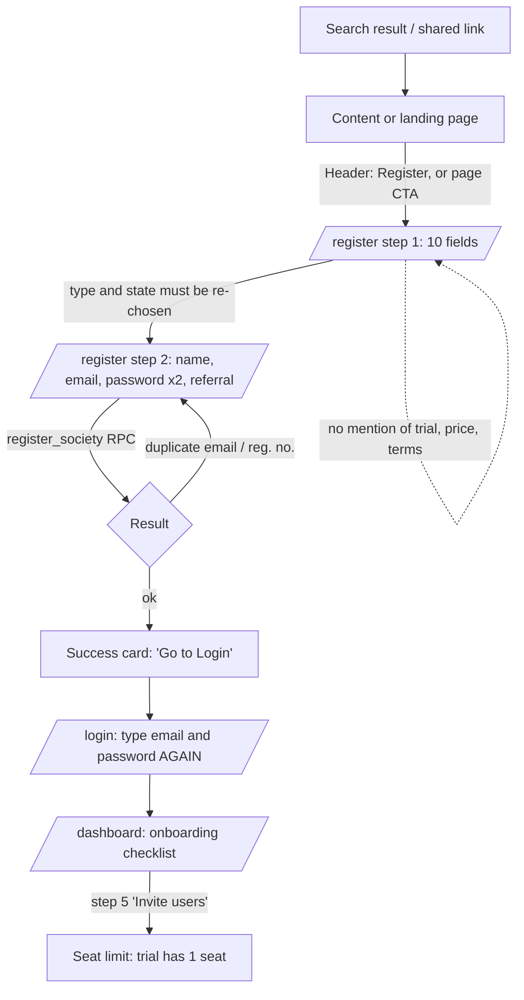
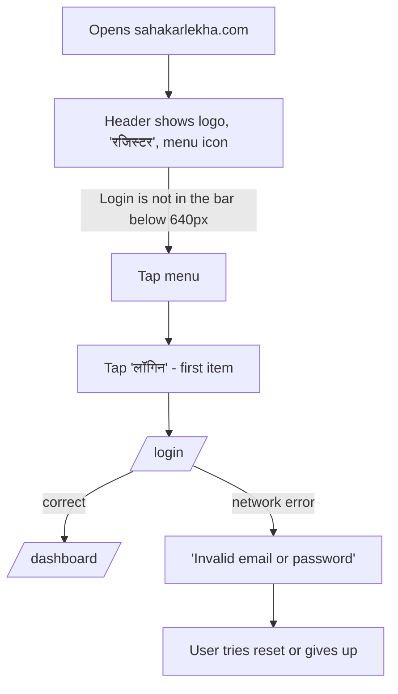
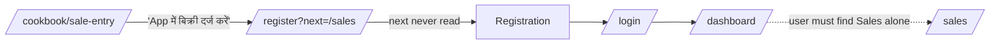
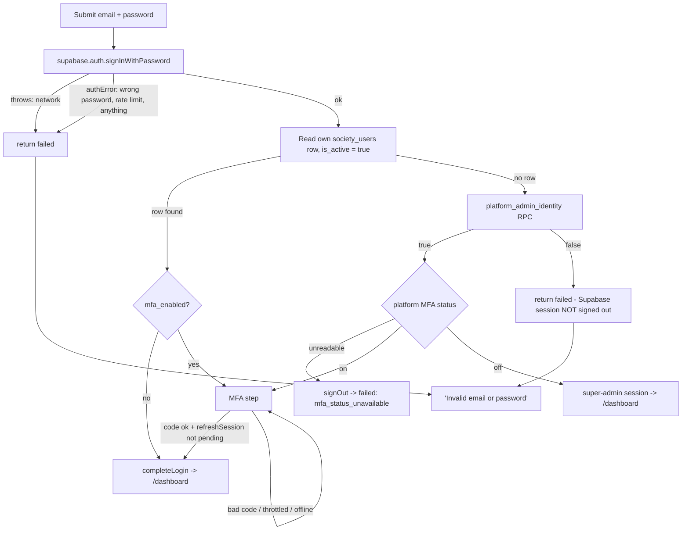
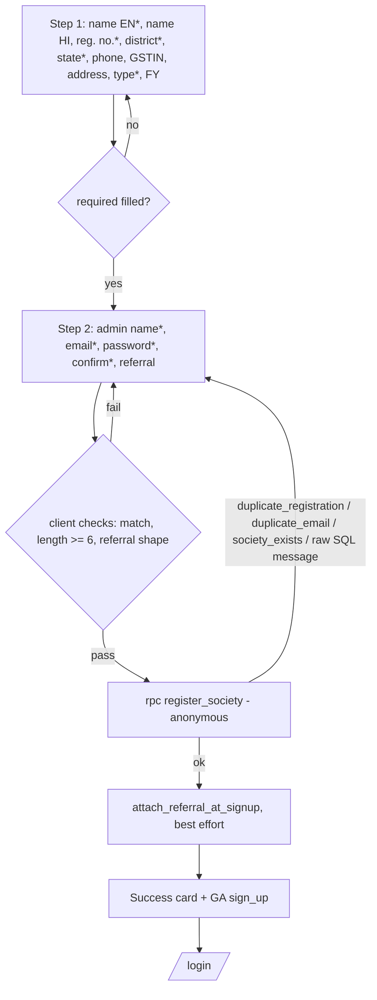
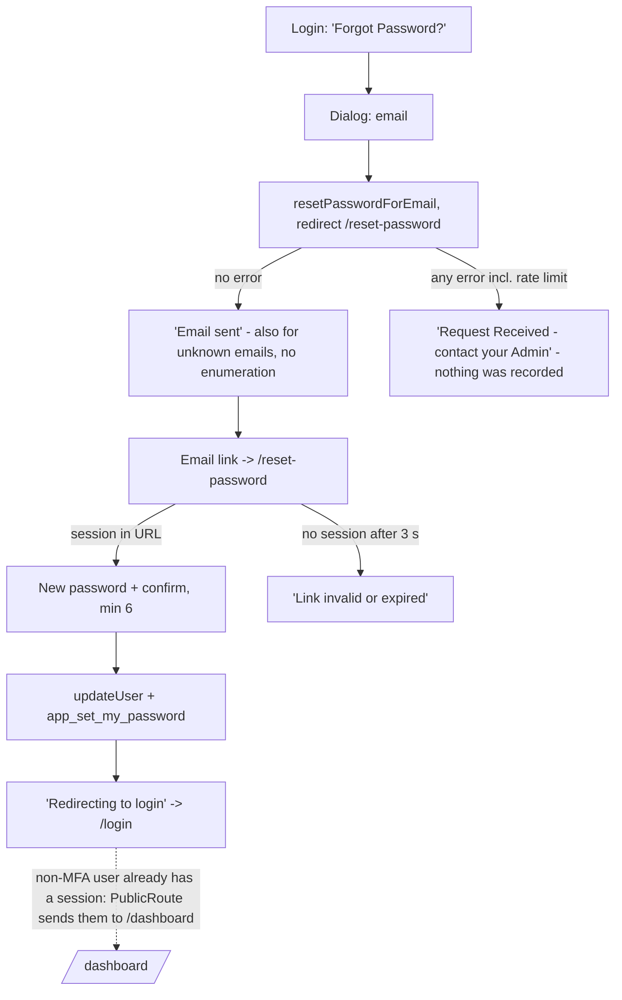
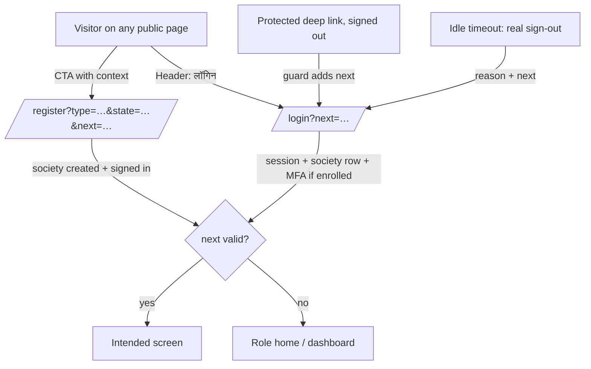

# SahakarLekha — User Journey, Conversion & Authentication Experience Audit

**Date:** 2026-11-16 · **Branch audited:** `feat/cd-withdrawal-setting` (HEAD `aac2dde`) · **Mode:** read-only audit. No code, schema or configuration was changed.

**Companion document:** [SAHAKARLEKHA-USER-JOURNEY-ROUTES.md](SAHAKARLEKHA-USER-JOURNEY-ROUTES.md) (route-by-route map).

## How to read this report

Every finding carries an evidence level:

| Level | Meaning |
|---|---|
| **Confirmed (code)** | I read the cited lines and the behaviour follows directly from them. |
| **Confirmed (measured)** | Measured in the running dev build (`npm run dev`, localhost) at a 320×640 viewport. Only public pages were opened; no form was submitted, no login attempted. |
| **Needs live verification** | The code supports the finding, but the outcome depends on something not in the repository (hosted Supabase Auth settings, live policies, constraints). Not executed. |
| **Not verified** | Reported by a research sub-agent or inferred; I did not re-read the lines. Marked individually. |

What was **not** done: no login, registration, password reset or payment was executed against any environment; no production or staging database was queried; no external product was opened (section 13 is general practice, not observation); only 320 px was measured in a browser — the other widths are read from the Tailwind breakpoints in the code. `git fetch` was not run, so `main` may have moved.

---

## 1. Executive Summary

The public site does its first job well: a visitor can tell within seconds what the product is, the price is stated, the header "Register" button is visible at every width, and the old unverifiable customer counts have been removed. The authentication core is also sound in design — one Supabase Auth root, MFA bound to the session server-side and failing closed, tenant RLS keyed on the verified JWT email, legacy plaintext paths retired.

The weak part is the **middle of the journey**: the hand-off from "interested" to "inside the right dashboard". Eleven things matter most.

**Security (fix before any conversion work)**

1. **`register_society` trusts client-built rows (S-1, High, needs live verification).** The anonymous signup RPC inserts `p_accounts` rows without checking that their `society_id` equals the society being created (`supabase/migrations/006_register_society_rpc.sql:58-74`). `accounts.id` is the sole primary key (`supabase-tables.sql:106`), so an anonymous caller may be able to add ledger heads to *another* society's chart. A society's id is not secret — it is in every member-portal link (`/member/:societyId`). Not executed; must be tested on staging.
2. **The 30-minute idle logout does not sign out of Supabase (S-2, Medium, confirmed).** The timer calls `doLogout`, which clears only React state and the app's localStorage key (`src/contexts/AuthContext.tsx:225-234`). The Supabase token stays in the browser, so pressing F5 on the login page signs the user straight back in (`:238-270`). On a shared office computer the timeout protects nothing.
3. **Deactivating a user does not end their access (S-3, Medium–High, needs live verification).** Deactivation is one client update whose error is never checked (`src/pages/UserManagement.tsx:328-338`), and `get_current_society_id()` deliberately has no `is_active` filter (`supabase/migrations/097_current_society_id_case_insensitive.sql:12,30-32`).
4. **Signup creates a confirmed account with no proof of email ownership (S-4, Medium, confirmed).** `email_confirmed_at = now()`. A typo in the email at registration locks the society's only admin out permanently; anyone can also occupy someone else's email.

**Journey defects**

5. **Every failure at login says "Invalid email or password" (J-1, confirmed).** Network failure, Supabase outage, rate limiting and a deactivated account all fall through to the same message (`AuthContext.tsx:410-461,498`; `src/pages/Login.tsx:72`). A user on a weak rural connection is told their correct password is wrong.
6. **"Forgot User ID" is a form that does nothing (J-2, confirmed).** It collects a name and phone number, discards them, and shows "Request noted" (`Login.tsx:124-128,512-527`). The fallback branch of "Forgot password" has the same false "Request Received" (`Login.tsx:446-461`).
7. **The intended destination is always lost (J-3, confirmed).** Help and Cookbook buttons send `/register?next=<screen>`; nothing reads `next`. A protected deep link redirects to `/login` with no return path, and login always goes to `/dashboard` (`src/AppDataShell.tsx:58`, `Login.tsx:55,89`).
8. **Registration ends at a second login form (J-4, confirmed).** After the #1 conversion event the user must type the email and password again (`src/pages/Register.tsx:239`).
9. **The trial promise disappears on the Register page (J-5, confirmed).** Pricing says "30 दिन मुफ़्त"; Register mentions neither trial, price, terms nor privacy. Calculator pages say "बिल्कुल मुफ्त / completely free" for a paid product (`src/pages/CalculatorHub.tsx:114`).
10. **Invited staff cannot exist during the trial (J-6, confirmed).** The trial has one seat (`supabase/migrations/057_new_society_trial.sql:22`), yet onboarding step 5 is "Invite users" (`src/components/dashboard/OnboardingChecklist.tsx:49`). There is also no invitation: the admin types the employee's password and must pass it on by hand.
11. **Non-admin staff hit a dead end when the plan expires (J-7, confirmed).** Every expiry banner links to `/user-management`, which is admin-only, so they are bounced to the dashboard with "This feature is not available for your society."

**Measurement.** GA4 is installed and `login` / `sign_up` success events exist, but there is no event for login submit, login failure, registration start, the step 1→2 transition, password reset, or any Pricing or landing CTA. **No baseline rate can be stated from the repository** — section 20 lists what is unknown.

**Recommended order:** Sprint 1 fixes S-1…S-4 and J-1…J-3 (correctness, no visual redesign). Only then is conversion work worth measuring.

---

## 2. Verified Architecture Overview

| Layer | What exists | Evidence |
|---|---|---|
| Build | Vite + React 18 + React Router 6 SPA, TypeScript, Tailwind + shadcn/Radix | `package.json:6-10,529-536` |
| Entry | `src/main.tsx` → `App` | `src/main.tsx:16` |
| Provider order | QueryClient → Language → **Auth** → Tooltip → BrowserRouter → `AppDataGate` → routes | `src/App.tsx:530-546` |
| Public/app split | Data providers mount only on app paths; public first segments are listed in `PUBLIC_SEGMENTS` | `src/App.tsx:517-528`, `src/lib/appDataPaths.ts:9-22` |
| Route guard (app) | `ProtectedShell`: not authenticated → `/login`; data loading → spinner; else layout + `CapabilityGuard` | `src/AppDataShell.tsx:49-73` |
| Route guard (guest) | `PublicRoute` on `/login`, `/register`: authenticated → `/dashboard` | `src/App.tsx:249-257,295-296` |
| Platform admin | `SuperAdminRoute` | `src/components/SuperAdminRoute.tsx:13-20` |
| Capability / role / plan gate | `CapabilityGuard` — same predicate as the sidebar; blocked → `/dashboard` + toast; plan missing → upgrade notice | `src/components/CapabilityGuard.tsx:26-67` |
| Identity | Supabase Auth email + password. `society_users` row (matched on lower-cased email) supplies role, society, branch | `src/contexts/AuthContext.tsx:408-422` |
| App session | A second copy in localStorage key `sahayata_auth` (email, name, role, societyId, branchId) | `src/lib/authSession.ts:9-26` |
| MFA | TOTP + recovery codes; `mfa_pending` claim stamped by the access-token hook; server helpers return nothing for a pending token | `supabase/migrations/085_mfa_session_binding.sql:118-175`, `src/lib/auth/mfaPending.ts` |
| Tenant isolation | RLS `society_id = get_current_society_id()` (JWT email → `society_users`) | `supabase/migrations/097_…sql:23-33` |
| Registration | Anonymous `register_society` RPC (society + confirmed admin + settings + chart, atomic) | `supabase/migrations/006_register_society_rpc.sql`, `src/pages/Register.tsx:134-169` |
| Trial | DB trigger: plan `trial`, 30 days, **1 seat** | `supabase/migrations/057_new_society_trial.sql:12-32` |
| Staff creation | Admin/secretary calls `app_add_society_user` with a password they choose | `src/pages/UserManagement.tsx:278-285`, `supabase/migrations/056_seat_cap_enforcement.sql:34-96` |
| Other logins | Member portal (`/member/:societyId`, member no. + PIN, own client); Partner portal (`/partner/login`, email + code) | `src/App.tsx:335,306`, `src/pages/PartnerPortal.tsx:78` |
| Analytics | GA4 only, production host only, never for automated browsers | `index.html:27-59`, `src/lib/analytics.ts` |
| Tests | ~470 node scripts + Playwright (staging only). No vitest/jest | `package.json:17-483`, `playwright.config.ts` *(not verified by me)* |

**Corrections to the brief's assumptions**

- `src/lib/auth/authRoot.ts` is a **pure policy module that the login path does not call**. Its own header says the live wiring is "the deferred half" (`authRoot.ts:12-16`). The real login is `AuthContext.login`.
- The dual-auth transition is **over in code**: the JWT-less `app_login` path and the plaintext platform-admin path are removed (`AuthContext.tsx:463-480`). `society_users.password` still exists as a column but is force-blanked; dropping it was planned and never shipped *(sub-agent finding, `094:10`, not re-read)*.
- There is **no society picker and no multi-society login**. `society_users.email` is `unique` (`supabase-tables.sql:65`), so one email belongs to exactly one society.
- There is **no email or mobile OTP at signup, no mobile-number login, no social login, no invitation link, and no book-a-demo flow**. Recommendations below do not assume any of them.
- `src/components/ProtectedRoute.tsx` is **dead code** (no importer); it is the only place that passes `state.from`, and nothing reads it.
- There is no `supabase/config.toml`. Password policy, auth rate limits, site URL and redirect allow-list live only in the hosted dashboard and could not be audited.

---

## 3. Complete Public Route Inventory

Source: `src/App.tsx:295-346`. "Chrome" = the shared `PublicLayout` header and footer. Full per-route detail is in the companion document.

| Route | Page | Chrome | Path to register | Path to login |
|---|---|---|---|---|
| `/` | LandingPage | Yes | Hero, final band, header | Header (≥640 px) / drawer |
| `/login` | Login | **None** | Text link | — |
| `/register` | Register | **None** | — | Text link |
| `/reset-password` | ResetPassword | None | — | Button |
| `/verify-email` | VerifyEmail | None | — | via `/dashboard` |
| `/email-unsubscribe` | EmailUnsubscribe | None | — | via `/dashboard` |
| `/pricing` | Pricing | Yes | 3 plan cards + bottom | Header |
| `/software`, `/software/:type` | SoftwareLanding | Yes | Hero, bottom | Header |
| `/cooperative-software/:state` | StateLanding | Yes | Hero, bottom | Header |
| `/blog`, `/blog/:slug` | BlogIndex / BlogPost | Yes | Bottom card only | Header |
| `/blog/category/:cat` | BlogCategory | Yes | **Header only** | Header |
| `/glossary`, `/glossary/:slug` | Glossary / GlossaryTerm | Yes | Term: bottom card; hub: header only | Header |
| `/tools`, `/tools/:slug` | CalculatorHub / Page | Yes | Bottom ("Register free") | Header |
| `/downloads` | DownloadsHub | Yes | One text link | Header |
| `/help`, `/help/:slug` | HelpHub / HelpArticle | Yes | Article: `?next=` button | Header |
| `/cookbook`, `/cookbook/:slug` | CookbookHub / Entry | Yes | Entry: `?next=` button | Header |
| `/guide`, `/guide/quick-start`, `/guide/:slug`, quiz, certificate, verify | Guide pages | Yes | Hub + quick-start bottom | Header |
| `/faq` | FAQ | Yes | Bottom | Header |
| `/about` | AboutUs | Yes | **Header only** | Header |
| `/contact` | ContactUs | Yes | **Header only** | Header |
| `/search`, `/ask` | SiteSearch / AskAssistant | Yes | Header only | Header |
| `/privacy`, `/terms`, `/editorial-policy`, `/author/:slug` | Legal / editorial | Yes | Header only | Header |
| `/partner`, `/partner/status`, `/partner/login`, `/partner/portal` | Partner program | Yes | — (separate audience) | Own login |
| `/member/:societyId` (+ `/sadasya/…` redirect) | MemberPortal | None | — | Own login |
| `/verify-backup` | VerifyBackup | None | — | — |
| `*` | NotFound | Yes | Header only | Header |

English twins exist under `/en/…` for most content pages; `/login`, `/register`, `/software`, `/downloads` have none and follow the saved language instead *(not verified by me: `src/lib/enRoutes.ts`)*.

---

## 4. User Journey Maps

### 4.1 The seven user types and what the product offers each today

| User | What they need | What exists | Gap |
|---|---|---|---|
| A. Returning staff | Login fast, land where they were | `/login` → `/dashboard` | Login hidden behind the menu below 640 px; destination lost; errors misleading |
| B. First-time visitor (exploring) | See the product without commitment | 1-minute video, sample PDF, screenshots | No sandbox; registering requires a real registration number |
| C. New society admin | Register, start trial | 2-step form, 30-day trial auto-starts | Trial not mentioned on the form; ends at a second login; type/state not carried from the page they came from |
| D. Invited employee / accountant | Get access to an existing society | Admin creates the login and tells them the password | No invitation, no first-login password change, impossible on the 1-seat trial |
| E. Account exists, no society access (deactivated / email changed) | Be told why | "Invalid email or password" | Wrong message; stale token left behind |
| F. Forgot credentials | Recover alone | Email reset link works | "Forgot ID" is a no-op; sole admin told to "contact your Admin" |
| G. Expired / restricted plan | Know what still works, pay | Banner; reports and export still work; pay in User Management | Non-admins are sent to a page they cannot open |
| (H. Society member) | Own statement | `/member/:societyId` | `/login` gives no pointer for a member who lands there |
| (I. Accountant serving several societies) | One login, many societies | **Not supported** — one email = one society | Needs a different email per society; undocumented |

### 4.2 New society administrator (today)

### 4.3 Returning user on a phone (today)

### 4.4 Content reader with intent (Help / Cookbook)

---

## 5. Login and Registration Flow Diagrams

### 5.1 Login (`AuthContext.login`, `src/contexts/AuthContext.tsx:408-499`)

The two arrows into `MSG` from a network failure and from a deactivated account are findings J-1 and J-8.

### 5.2 Registration (`src/pages/Register.tsx`)

### 5.3 Password reset

---

## 6. Authentication State Machine

| # | State | How it is represented | Entered from | Leaves to | Recovery when it goes wrong |
|---|---|---|---|---|---|
| 1 | Unauthenticated | `user === null` | first visit, logout, timeout | 2 | — |
| 2 | Credentials submitted | `isLoading` on the form; button disabled | 1 | 3, 4, 5, 12 | Button re-enables |
| 3 | MFA pending | `pendingMfaRef` (memory only) + JWT claim `mfa_pending: true` | 2 | 5, 1 (Back) | Recovery code; admin reset. A reload signs the pending session out (`AuthContext.tsx:242-246`) |
| 4 | Authenticated, **no society row** | Supabase session exists, `user === null` | 2 (deactivated / email mismatch) | 12 | **None — shown as wrong password; token left in storage** |
| 5 | Authenticated | `user` set + `sahayata_auth` in localStorage | 2, 3, restore | 6 | — |
| 6 | Data loading | `useData().isLoading` → spinner (Hindi-only text) | 5 | 7 | No visible error or retry state in the shell |
| 7 | Capability / role resolution | `CapabilityGuard` | 6 | 8, 9, 10 | Redirect to `/dashboard` + toast |
| 8 | Plan-restricted page | `PlanUpgradeNotice` | 7 | pay, pricing | Buttons to `/user-management` and `/pricing` |
| 9 | Subscription grace / expired | Banner; voucher creation blocked client-side | 7 | pay | Admin pays in User Management; **non-admin: dead end** |
| 10 | Dashboard ready | page renders | 7 | 11 | — |
| 11 | Session ended | (a) 30-min idle timer → local logout only; (b) Supabase `SIGNED_OUT`; (c) another tab logs in as someone else → entry blocked until reload | 10 | 1 | Silent redirect to `/login`; no "you were signed out" message; no return path |
| 12 | Authentication failed | error text in the form | 2 | 1 | Same message for every cause |

**States in the brief that do not exist in the product:** "Verification pending" at signup (accounts are pre-confirmed), "Profile incomplete", "Society selection pending", "Membership or invitation pending".

**Pre-verification window.** On a cold load `user` is initialised from localStorage before the Supabase session is checked (`AuthContext.tsx:200`, `restoreSession` `:110-133`). For a moment the shell trusts a client-editable role and society id. Data is still protected by RLS, and a session with no JWT is cleared on non-localhost hosts (`:247-255`), so this is a UI-only exposure (S-7, Low). However, if a JWT exists but the `society_users` row is gone, the stale app session is **kept** (`:288-290` clears only the super-admin flag): the deactivated user sees the app frame with whatever RLS still returns.

---

## 7. UX Friction Register

Severity: **H** blocks or misleads; **M** costs effort or confidence; **L** polish.

| ID | Friction | What the user feels | Technical root cause | Business impact | Sev | Recommended correction | Evidence |
|---|---|---|---|---|---|---|---|
| J-1 | All login failures read "Invalid email or password" | "My password is wrong" → resets needlessly, or gives up | `authError` is never inspected; a thrown network error falls through to the same return | Lost logins on weak networks; support load | H | Distinguish: no network / service unavailable / too many attempts / wrong credentials / account inactive. Keep the credential message generic | `AuthContext.tsx:410-461,498`; `Login.tsx:72` |
| J-2 | "Forgot User ID" pretends to file a request | Told "Request noted"; nothing happens | `handleForgotIdSubmit` only flips a flag | Broken trust at the most anxious moment; personal data typed for no purpose | H | Replace with honest guidance: where the login email is found (welcome message, the admin's User Management screen) + WhatsApp support link. No form | `Login.tsx:124-128,472-534` |
| J-2b | Reset fallback says "Request Received" | Same | Any reset error (incl. rate limit) maps to this branch | Same | H | Show "could not send right now — try again in a minute" + support link | `Login.tsx:118-121,446-461`; `AuthContext.tsx:569-572` |
| J-3 | Destination lost through auth | "I clicked 'record a sale' and I'm on a dashboard" | `?next=` unread; guard passes no state; login hard-codes `/dashboard` | Content-to-product bridge broken; expired-session work lost | H | One validated `next` parameter honoured by Register, Login, PublicRoute and the guard (section 15.3) | `HelpArticle.tsx:90`; `CookbookEntry.tsx:76`; `AppDataShell.tsx:58`; `Login.tsx:55,89`; `App.tsx:253` |
| J-4 | Register ends at a login form | "I just typed this" | Success card navigates to `/login`; no session is created | Drop-off between sign-up and first dashboard view (unmeasured) | H | Sign in with the credentials just entered, then go to the dashboard; fall back to today's card if that fails | `Register.tsx:207-246` |
| J-5 | Trial / price / terms absent on Register | "Is this free? Will I be charged?" | No copy on the page; no link to terms or privacy | Hesitation at the form; consent gap | H | One line under the title: 30-day trial, 1 user, no payment now; links to pricing, terms, privacy | `Register.tsx` (no match for trial/free/terms) |
| J-5b | "Completely free" on calculator pages; JSON-LD `price: '0'` | Feels misled later | Stale copy | Trust; also a public-claims issue | M | Align with "30 दिन मुफ़्त trial, फिर ₹2,999/साल + GST से" | `CalculatorHub.tsx:114,117`; `CalculatorShell.tsx:89,129,452`; `Testimonials.tsx:61` |
| J-6 | No invitation; admin sets the employee's password; trial has 1 seat | Employee: "who do I ask?" Admin: "why can't I add my accountant?" | `app_add_society_user(p_password)`; trigger sets `seats_limit 1`; checklist still offers "Invite users" | Team adoption impossible during evaluation | H | Short term: checklist step says the trial is single-user; User Management shows the password hand-over instruction. Strategic: real invitation (section 15) | `056_…sql:34-96`; `057_…sql:22`; `OnboardingChecklist.tsx:49`; `UserManagement.tsx:195-202` |
| J-7 | Expiry banner sends non-admins to an admin-only page | "It says not available for my society" | Banner target `/user-management`, `requiredRoles: ['admin']` | Staff cannot tell the admin what to do | H | For non-admins the banner says "ask your admin to renew" with no link | `moduleCatalog.ts:203`; `CapabilityGuard.tsx:46-58`; `SubscriptionBanner.tsx:21` *(banner line not re-read)* |
| J-8 | Deactivated user told "wrong password" | Confusion; repeated attempts | No-row path returns `failed` | Support load | M | "This login is not active — contact your society admin", and sign the Supabase session out | `AuthContext.tsx:413-458` |
| J-9 | Login link hidden below 640 px | Returning phone user hunts for it | `hidden sm:inline-flex`; drawer only | Extra taps on the most frequent action | M | Show a compact "लॉगिन" text link in the bar at every width (fits beside "रजिस्टर" at 320 px if the logo subtitle is dropped below 360 px) | `PublicLayout.tsx:183-185,214-216`; measured |
| J-10 | Society type and state are re-asked | "I was on the dairy page" | CTAs are bare `/register`; Register reads no params | Extra steps; wrong-type risk (type decides chart and modules) | M | `/register?type=dairy&state=HR`, validated against the known lists | `SoftwareLanding.tsx:165,320`; `StateLanding.tsx:87,140`; `Register.tsx:38,61` |
| J-11 | Register step 1 is ten fields before the account exists | Long; needs a document (registration number) to continue | Everything collected up front | Abandonment (unmeasured) | M | Keep name, type, state, registration no. in step 1; move phone, GSTIN, address, Hindi name to Society Setup (the checklist already sends them there). Test before removing (E-4) | `Register.tsx:324-453` |
| J-12 | Typed data lost on refresh or back | Re-typing | Component state only | Abandonment | M | Keep step-1 fields (never the password) in `sessionStorage` | `Register.tsx:34-83` |
| J-13 | Same message for a role block and a society-type block | "Not available for your society" when the cause is the role | One toast | Confusion | L | Separate wording | `CapabilityGuard.tsx:46-56` |
| J-14 | No message after timeout or sign-out | "Why am I on the login page?" | Silent redirect | Confusion; unsaved work lost | M | "सुरक्षा के लिए आप लॉगआउट हो गए" on `/login`; warn one minute before | `AuthContext.tsx:231-234,297-298` |
| J-15 | Login and Register have no way back to the site | Stuck | Own layouts; logo is not a link | Small | L | Logo → `/`; "मूल्य देखें" link on Register | measured |
| J-16 | A member who opens `/login` gets no pointer | Member tries staff login | No copy | Support load | L | One line: "सदस्य हैं? अपनी समिति से सदस्य पोर्टल का लिंक लें" | `Login.tsx` |
| J-17 | "Demo / Contact" leads to a generic message form | Expected a demo | No demo flow exists | Mismatch | L | Rename to "संपर्क करें", or point to the video | `SoftwareLanding.tsx:321`; `StateLanding.tsx:141` |
| J-18 | Glossary "do this in SahakarLekha" buttons go to app routes for logged-out visitors | Dumped on `/login` | No `isAuthenticated` branch (Help/Cookbook have one) | Dead end | M | Same treatment as Help/Cookbook once `next` works | `GlossaryTerm.tsx:211-218` *(not re-read)* |
| J-19 | One accountant cannot serve two societies with one email | "Email already registered" | `society_users.email unique`; `.maybeSingle()` | Blocks a real, common role | M (strategic) | Document the limitation now; design multi-society membership later (needs schema + RLS approval) | `supabase-tables.sql:65`; `056_…sql:60-65` |
| J-20 | Eight different labels for the same `/register` action | Unsure whether they differ | Ad-hoc copy | Dilutes measurement too | L | Two labels only (section 10) | section 10 |
| J-21 | Password rule shown only as a placeholder; minimum 6 | Rule vanishes on typing | Placeholder text | Weak passwords; a11y | M | Persistent hint under the field; see S-5 | `Register.tsx:484` |
| J-22 | Raw server text can reach the user in English | Unreadable error | `result.error_message || rpcError?.message` | Confusion; minor disclosure | L | Map to a fixed bilingual message; log the detail | `Register.tsx:181`; `006_…sql:86` |

---

## 8. Security Findings

Nothing here was exploited. "Needs live verification" items must be tested on **staging**, never production.

| ID | Finding | Risk | Evidence level | Evidence | Recommendation |
|---|---|---|---|---|---|
| S-1 | `register_society` inserts client-supplied `accounts`, `societies` and `society_settings` rows without checking they belong to the society being created. Anonymous, no rate limit. | **High** (possible cross-tenant write) | Code confirmed; exploit **not** executed | `006_register_society_rpc.sql:58-74,92-93`; `supabase-tables.sql:106-107` | In the RPC, force `id`/`society_id` of every row to `p_society_id` (overwrite, do not trust). Add a staging test that tries a foreign `society_id` and must fail. Schema change → needs approval |
| S-2 | Idle timeout clears the UI only; the Supabase refresh token remains, and a reload restores the session | **Medium** | Confirmed (code) | `AuthContext.tsx:225-234,238-270` | Timeout must call `supabase.auth.signOut()` (the existing `logout`), and show the reason |
| S-3 | Deactivation: unchecked client update; `get_current_society_id()` ignores `is_active`; no Auth-side revocation | **Medium–High** | Needs live verification | `UserManagement.tsx:328-338`; `097_…sql:12,30-32` | Check the update's error and roll the toggle back on failure (CLAUDE.md RULE 1). Server: add `is_active` to the helper and end the user's sessions — RLS change → needs approval |
| S-4 | No email-ownership proof at signup; accounts are pre-confirmed | **Medium** | Confirmed (code) | `094_…sql:150` *(not re-read)*; `056_…sql:70-77` shows the same pattern | The verification mechanism already exists (`/verify-email`, migration 142). Ask for it right after first login and require it before inviting users or paying; do not block the first session |
| S-5 | Minimum password length 6, no other check, in client and SQL | **Medium** | Confirmed (code); hosted policy unknown | `Register.tsx:112`; `ResetPassword.tsx:53`; `056_…sql:57` | Raise to 8+ for **new** passwords only (existing users unaffected until they change it). Do not add composition rules that punish Hindi-keyboard users; length is what matters |
| S-6 | Account-existence oracle on the anonymous signup RPC (`duplicate_email`, `duplicate_registration`); raw `SQLERRM` returned | **Low–Medium** | Confirmed (code) | `006_…sql:52-55,82-86` | Accept the registration-number message (useful to honest users); add rate limiting; replace raw `SQLERRM` with a code |
| S-7 | App session bootstrapped from client-editable localStorage before verification; stale session kept when a JWT exists but the society row does not | **Low** (UI only; RLS still applies) | Confirmed (code) | `AuthContext.tsx:110-133,200,288-290` | Treat the restored session as "pending" until verified; clear it when no row and not a platform admin |
| S-8 | Successful Supabase sign-in with no society row leaves a live token in storage | **Low** | Confirmed (code) | `AuthContext.tsx:412-458` | Sign out on that path |
| S-9 | Subscription expiry is enforced only in the browser | **Medium** (revenue, not data) | Sub-agent finding, not re-verified | `DataContext.tsx:1107-1117` | Server-side check in the posting RPC — needs approval |
| S-10 | Route gate matches the path exactly; a trailing-slash or case variant may be treated as "no catalog entry → allowed" | **Low–Medium** | **Not verified, not tested** | `routeModule.ts:10-19` | Normalise the path before matching; add a script test. RLS still protects data |
| S-11 | Password-reset response and email logged to the browser console | **Low** | Confirmed (code) | `AuthContext.tsx:521,525,552` | Remove |
| S-12 | No app-level throttle on staff password login; relies on hosted Supabase limits that are not in the repo | **Unknown** | Cannot be audited from files | no `supabase/config.toml` | Record the dashboard settings in `docs/` so they can be reviewed |
| S-13 | Free-text search queries and in-app paths with record ids are sent to GA4; no consent gate | **Low–Medium** (privacy) | Sub-agent finding, not re-verified | `analytics.ts:42-48`; `useBlogSearch.ts:32` | Strip ids and queries from app-route page views; decide on consent with legal advice |
| S-14 | Old root SQL files still define permissive policies and plaintext `app_login` | **Low** (only if someone re-runs them) | Sub-agent finding, not re-verified | `supabase-security.sql:151-160` | Add a "superseded — do not run" header or move to an archive folder |

**Checked and found sound**

- **Open redirect:** none today — no redirect parameter is honoured anywhere. This becomes a live risk the moment `next` is implemented (section 15.3 gives the validation rule).
- **MFA:** fail-closed on every path read: unreadable status refuses login (`AuthContext.tsx:444-448`); a pending token yields no society (`085:169-175`); reload mid-challenge signs out (`:242-246`); 5 failures / 15 min throttle (`085:89-93`).
- **Platform admin:** derived from the verified JWT by RPC, never from localStorage (`AuthContext.tsx:142-149,273-290`).
- **Password reset:** the same "email sent" for known and unknown addresses on the normal path; reset RPC takes identity from the JWT.
- **XSS:** the one `dangerouslySetInnerHTML` in the shell re-inserts the page's own prerendered HTML (`App.tsx:262-263`). Not a user-input sink.
- **CSRF:** bearer-token API, no cookie session — not applicable in the classic sense.
- **UI gating vs. server:** `CapabilityGuard` states it is presentation-layer only (`CapabilityGuard.tsx:10-12`); tenant isolation is RLS.

---

## 9. Mobile UX Findings

Measured at **320×640** in the dev build. Other widths are derived from breakpoints, not measured.

| ID | Finding | Evidence | WCAG 2.2 | Fix |
|---|---|---|---|---|
| M-1 | No horizontal page scroll on `/`, `/login`, `/register` (document width = viewport) | measured | — | Keep; add a test |
| M-2 | Header at <640 px: logo, "रजिस्टर" (80×36), menu (40×40). **No Login in the bar**; it is the first drawer item (239×49) | measured; `PublicLayout.tsx:183-185,214` | — | J-9 |
| M-3 | Show/hide password button is **16×16 px with no accessible name**, on Login, Register and Reset | measured; `Login.tsx:311-317`; `Register.tsx:488-494`; `ResetPassword.tsx:188-194` | 2.5.8 Target Size (24 px), 4.1.2 Name/Role/Value | 44×44 hit area; `aria-label` that changes with state; `aria-pressed` |
| M-4 | "पासवर्ड भूल गए?" is 72×16; "User ID / ईमेल भूल गए?" 145×20; register / demo / WhatsApp links 20–22 px tall | measured | 2.5.8 (inline-link exception may apply; still hard to tap) | Min 44 px tall rows on mobile |
| M-5 | Login and Register inputs have **no `autocomplete` and no `name`** | measured (`ac=null`, `name=null`) | 1.3.5 Identify Input Purpose | `username` / `current-password` on Login; `name`, `email`, `new-password`, `tel`, `organization` on Register. Biggest single help for password managers on Android |
| M-6 | **All ten Register labels are not associated with their inputs** (`<label>` without `for`) | measured (`labelsFor: (none) ×10`); `Register.tsx:326-448` | 1.3.1, 3.3.2, 4.1.2 | `htmlFor` + `id` on every pair; same in the two Login dialogs (`Login.tsx:404,489,498`) |
| M-7 | Register phone field is plain text; no numeric keyboard | measured (`type=null`); `Register.tsx:381-385` | — | `type="tel"`, `inputMode="tel"` |
| M-8 | Register step 1 is 1,331 px tall at 320 px (over two screens) before "Next" | measured | — | J-11 |
| M-9 | Landing page is 13,156 px tall at 320 px; the next register CTA after the hero is at the very bottom | measured | — | One mid-page CTA after the demo section (section 10) |
| M-10 | Hero CTAs are an `<a>` wrapping a `<button>` | measured (A and BUTTON at the same box) | 4.1.2 (nested interactive) | Use the Button's `asChild` so one element is rendered |
| M-11 | Required fields are marked only by a red `*` | `Register.tsx:326,345,356,365,409` | 3.3.2, 1.4.1 | Add `aria-required`, and a "* ज़रूरी" legend |
| M-12 | Errors appear in an alert at the top of the card, not next to the field; focus is not moved | `Login.tsx:266-271`; `Register.tsx:316-321` | 3.3.1, 4.1.3 | Keep the alert (it has `role="alert"`), also set `aria-invalid` and focus the first bad field |
| M-13 | Step change on Register does not move focus or announce "Step 2 of 2" | `Register.tsx:99,307-313` | 2.4.3, 4.1.3 | Focus the step heading |
| M-14 | Data-loading text is Hindi-only in the shell | `AppDataShell.tsx:66` | — | Use the language context |
| M-15 | Comparison table on the landing page is wider than the viewport (360 px at 320) inside a scroll container | measured | 1.4.10 Reflow (allowed for data tables) | Add a visible "→ scroll" hint |
| M-16 | Sheet close button's label is English "Close" in Hindi mode | `ui/sheet.tsx:62` *(not re-read)* | 3.1.2 | Localise |

**Not assessed:** colour contrast (needs a contrast tool on rendered pages), screen-reader passes with TalkBack, on-screen-keyboard overlap on a real Android device, 360/375/390/430 px and tablet rendering. These belong in Sprint 4's test pass.

---

## 10. CTA and Conversion Analysis

### 10.1 What exists

- The header "Register" button is on every content page at every width — good.
- Every other register CTA is at the **bottom** of its page (blog, glossary, tools, guide, FAQ). About, Contact, Blog category, Glossary hub, Search, Ask and 404 have none beyond the header.
- Eight labels point to the same `/register`: शुरू करें, रजिस्टर, रजिस्टर करें, पंजीकरण, मुफ्त रजिस्टर करें, 30 दिन मुफ़्त आज़माएँ, अभी शुरू करें, अपनी समिति डिजिटल कीजिए.
- The strongest true offer — a 30-day trial with nothing to pay now — appears on Pricing and Software pages but **not in the landing hero and not on Register**.
- Only blog-footer, glossary-footer, help, cookbook and three "thank-you" CTAs are tracked. Landing, Pricing, Software, State, Tools, Guide and header CTAs are not.

### 10.2 Which actions should exist

| Action | Verdict | Reason |
|---|---|---|
| Login | Yes, visible at every width | Most frequent action for the people who already pay |
| Register / start trial | Yes — one primary label | It is what the product actually offers |
| "Get Started" | **Merge** into the trial label | Vague; duplicates Register |
| View Pricing | Yes, secondary | Price is the main objection and is already public |
| Watch demo (video) | Yes, secondary | Exists and is genuine |
| Try a Tool | Yes, on tools pages only | Already the page's purpose |
| Contact / WhatsApp support | Yes, tertiary | Real channel; reassuring for low-confidence users |
| **Book a Demo** | **No** | No booking flow exists; today's "Demo/Contact" button over-promises (J-17) |
| "Explore Software" sandbox | **No (not now)** | Does not exist; the video and sample PDF serve this intent |

### 10.3 Proposed CTAs

All copy below states only what the code does today (30-day trial, 1 user, plans from ₹2,999/year + GST). If the trial terms change, the copy must change with `TRIAL_DAYS`.

| # | Wording (HI / EN) | Placement | Target | Segment | Expected effect (hypothesis, unmeasured) | Event |
|---|---|---|---|---|---|---|
| C-1 | **30 दिन मुफ़्त आज़माएँ** / Start 30-day free trial | Landing hero primary; header primary ≥1024 px; all bottom bands | `/register` | New admin | Removes the "is it paid now?" doubt at the first click | `cta_click {location, target:'register'}` |
| C-2 | **लॉगिन** / Login | Header at every width | `/login` | Returning | Fewer taps to the daily action | `cta_click {location:'header', target:'login'}` |
| C-3 | **1 मिनट का डेमो देखें** / Watch the 1-minute demo | Hero secondary (exists) | `#demo` | Explorer | — (exists; start measuring) | `cta_click {target:'demo'}` |
| C-4 | **{Type} समिति के लिए शुरू करें** / Start for a {type} society | `/software/:type` hero and bottom | `/register?type=<type>` | New admin, known type | Skips the type choice; correct chart from the start | `cta_click {location:'software', society_type}` |
| C-5 | Same as C-1 | `/cooperative-software/:state` | `/register?state=<code>` | New admin, known state | Skips the state choice; surfaces state presets | `cta_click {location:'state', state}` |
| C-6 | **इसे अपनी समिति में करें — 30 दिन मुफ़्त** / Do this in your own society — 30 days free | Help and Cookbook (replaces today's label for logged-out visitors) | `/register?next=<route>` | Reader with a task | Honest label: says registration comes first | `help_cta_click` / `cookbook_cta_click` (exist) |
| C-7 | C-1 | Landing, after the demo section (mid-page) | `/register` | Explorer who just watched | A CTA where intent peaks, on a 13,000 px page | `cta_click {location:'landing_demo'}` |
| C-8 | **मूल्य देखें** / See pricing | Register page, small link | `/pricing` (new tab not needed) | Hesitant registrant | Answers the price doubt without leaving for good | `cta_click {location:'register', target:'pricing'}` |
| C-9 | **मुफ़्त trial शुरू करें** / Start free trial | Tools pages (replaces "मुफ्त रजिस्टर करें") | `/register` | Tool user | Removes the "completely free" claim | `cta_click {location:'tools'}` |

On the question "should Login be consistently visible": **yes**. On "do new and existing users need separate paths": **yes** — two clearly different buttons in the header (C-1 filled, C-2 outline) are enough; a combined "Login / Register" page is not needed.

---

## 11. Analytics Event Taxonomy

### 11.1 What exists (GA4 `G-PB8FG0M5ET`)

Loaded only on `sahakarlekha.com`, never for automated browsers, no consent gate (`index.html:31-39`). Helper: `trackEvent(name, params)` (`src/lib/analytics.ts`). Existing funnel-relevant events: `page_view`, `login {method}` (success only), `sign_up {method}`, `cta_click {location, target, …}`, `help_cta_click`, `cookbook_cta_click`, `whatsapp_click`, `contact_submit`, plus product events (`voucher_created`, `member_added`, `society_setup_saved`). *(Full table from the sub-agent's grep; call sites in `Login.tsx:54,88,358,371` and `Register.tsx:209` verified by me.)*

### 11.2 Proposed additions

Naming follows what is already there: keep `login`, `sign_up`, `cta_click`; add only what is missing. No new provider.

| Event | Trigger | Properties | Segment | Privacy note |
|---|---|---|---|---|
| `cta_click` (extend) | Every register/login/pricing/demo CTA incl. header | `location`, `target`, `society_type?`, `state?` | by `location` | No free text |
| `login_form_start` | First keystroke in the login email field | — | returning | — |
| `login_submit` | Form submitted | — | returning | Never the email |
| `login` (exists) | Session established | `method`: `email` \| `email+mfa` \| `email+recovery`; **add** `role_group`: `admin` \| `staff` \| `platform` | all | Role group only, not the role name or society |
| `login_failure` | Any non-success | `reason`: `credentials` \| `network` \| `rate_limited` \| `inactive` \| `mfa_unavailable` \| `service` | all | Reason code only. Requires J-1 first |
| `mfa_challenge_view` / `mfa_failure` | MFA step shown / wrong code | `method`: `totp` \| `recovery` | MFA users | Never the code |
| `password_reset_start` | Reset dialog submitted | — | F | Never the email |
| `password_reset_success` | New password saved | — | F | — |
| `sign_up_start` | First keystroke on Register | `entry`: `direct` \| `software` \| `state` \| `help` \| `cookbook` \| `pricing` (from validated params) | new | — |
| `sign_up_step` | Step 1 → 2 | `step: 2`, `society_type` | new | Type is a category, not PII |
| `sign_up_failure` | Client validation or RPC error | `reason`: `required` \| `password_mismatch` \| `password_short` \| `duplicate_email` \| `duplicate_registration` \| `network` \| `server` | new | Code only |
| `sign_up` (exists) | Society created | `method`, **add** `society_type`, `has_referral` (boolean) | new | Not the code, not the name |
| `dashboard_first_view` | First dashboard render for a society with no members and no vouchers (the same condition the onboarding checklist uses) | — | new | — |
| `session_ended` | Idle timeout / forced sign-out | `reason`: `idle` \| `signed_out` \| `account_changed` | all | — |
| `plan_notice_view` / `plan_cta_click` | Expiry banner or upgrade notice shown / clicked | `state`: `trialing` \| `grace` \| `expired` \| `feature`, `role_group` | G | — |

**Not adopted from the suggested list:** `verification_*` at signup and `society_selection_*` — those steps do not exist. `landing_page_view` and `login_page_view` / `registration_page_view` are the existing `page_view` filtered by path; separate events would duplicate them.

**Hard rules:** never send email, phone, name, society name or id, registration number, GSTIN, password, OTP, token or referral code. Before adding more events, fix the existing leak: app-route `page_view` should send the route pattern (`/members/:id`), not the literal path (S-13).

---

## 12. Conversion Funnel Definitions

| # | Funnel | Numerator → denominator | Possible today? |
|---|---|---|---|
| 1 | Qualified visitor → login page view | sessions with `page_view /login` ÷ sessions landing on a public page | Yes (GA4 path exploration) — but "qualified" needs a definition; suggest: session with ≥2 page views or ≥30 s |
| 2 | Login page view → form start | `login_form_start` ÷ `page_view /login` | **No** (event missing) |
| 3 | Form start → submission | `login_submit` ÷ `login_form_start` | **No** |
| 4 | Submission → authentication success | `login` ÷ `login_submit` | **No** (no submit event) |
| 5 | Authentication success → dashboard access | `page_view /dashboard` after `login` ÷ `login` | Approximately (both exist) |
| 6 | New visitor → registration success | `sign_up` ÷ new users | Yes, coarse |
| 6a | Register page view → start → step 2 → success | `sign_up_start`, `sign_up_step`, `sign_up` | **No** (only the last exists) |
| 7 | New registration → first successful login | `login` within the same session or 24 h after `sign_up` | Approximately; disappears as a step if J-4 is fixed, replaced by `dashboard_first_view` ÷ `sign_up` |

**Two different rates, not to be mixed:** *conversion rate* = funnel 6 (a visitor becomes a registered society). *Login completion rate* = funnel 4 (a submitted login succeeds). The first is a marketing measure; the second is a reliability measure and should be near its ceiling — a low value means defects like J-1, not weak persuasion.

**Segments:** new vs. returning (GA4 built-in); admin vs. staff (`role_group`, proposed); device category (built-in). "Invited users" cannot be separated today because no invitation exists; until then, staff = invited.

**Dashboard (one GA4 exploration set, no new tooling):** (1) register funnel 6a by device and by `entry`; (2) login funnel 2–5 by device; (3) `login_failure` by `reason` per week; (4) `cta_click` by `location` with its downstream `sign_up` rate; (5) `sign_up` → `dashboard_first_view` → `voucher_created` (activation); (6) `password_reset_start` → `password_reset_success`. Staff-login reliability can also be read from Supabase Auth logs, which hold what GA cannot.

---

## 13. Competitive UX Benchmark

**I did not open or test any external product for this audit.** Nothing below is an observation of Zoho, TallyPrime, Razorpay, Microsoft 365, Google Workspace, FreshBooks or QuickBooks as they are today. These are widely used SaaS patterns from general knowledge, listed so they can be compared against SahakarLekha; verify against the live products before citing any of them.

| Pattern (general practice) | SahakarLekha today | Transferable? |
|---|---|---|
| Sign-in and sign-up both visible in the header at every width | Sign-up yes; sign-in hidden <640 px | Yes (C-2) |
| Sign-up asks for the minimum, completes the profile inside the product | 10 + 5 fields up front | Partly — the society type must stay (it decides the chart); test the rest (E-4) |
| New account lands inside the product, not at a login form | Lands at login | Yes (J-4) |
| Email ownership confirmed early, without blocking first use | Never confirmed | Yes (S-4), mechanism exists |
| Errors separate "we could not reach the server" from "wrong credentials" | One message | Yes (J-1) |
| Deep links survive sign-in | Lost | Yes (J-3) |
| Team members join by invitation and set their own password | Admin sets it | Yes, strategic (needs email sending, which exists via the outbox) |
| One identity, several organisations, with a switcher | One email = one society | Strategic; large; relevant for accountants (J-19) |
| Trial terms repeated next to the sign-up button | Only on Pricing | Yes (J-5) |
| Session-timeout warning before sign-out | None | Yes (J-14) |

Patterns deliberately **not** recommended: phone-OTP login (no SMS infrastructure in the repo; cost and delivery risk), social login (society accounts are institutional, not personal), "magic link only" (shared office inboxes).

---

## 14. Prioritized Issue Register

User impact (UI), conversion impact (CI), effort (E): 1–10. **Frequency is not scored — no data exists** (section 20). Ordered by the brief's priority classes.

| Rank | ID | Issue | UI | CI | E | Security risk | Confidence | Class |
|---|---|---|---|---|---|---|---|---|
| 1 | S-1 | Signup RPC trusts client rows | 9 | 1 | 3 | **High** | Medium (code yes, exploit untested) | Critical |
| 2 | S-2 | Idle timeout leaves token | 6 | 1 | 1 | Medium | High | Critical |
| 3 | S-3 | Deactivation not enforced | 7 | 1 | 4 | Medium–High | Medium | Critical |
| 4 | J-2 | "Forgot ID" / "Request received" false statements | 7 | 4 | 1 | Low | High | Broken journey |
| 5 | J-3 | Destination lost (`next`) | 7 | 7 | 4 | Low (if validated) | High | Broken journey |
| 6 | J-7 | Expiry dead end for staff | 6 | 3 | 1 | Low | High | Broken journey |
| 7 | J-1 | One error for all login failures | 9 | 6 | 2 | Low | High | Login blocker |
| 8 | J-8 / S-8 | Inactive account message + stale token | 5 | 2 | 1 | Low | High | Login blocker |
| 9 | S-4 | No email ownership proof (typo = lockout) | 7 | 3 | 4 | Medium | High | Login blocker |
| 10 | M-5 | No autocomplete on auth forms | 7 | 5 | 1 | Low | High | Mobile |
| 11 | M-3, M-4 | 16 px targets, unnamed buttons | 6 | 3 | 1 | Low | High | Mobile |
| 12 | M-6 | Register labels unassociated | 6 | 3 | 1 | Low | High | Mobile / a11y |
| 13 | J-9 | Login hidden on phones | 6 | 4 | 1 | Low | High | Mobile |
| 14 | J-4 | Register → second login | 7 | 8 | 3 | Low | High | Conversion friction |
| 15 | J-5 | Trial / terms missing on Register | 6 | 7 | 1 | Low | High | Conversion friction |
| 16 | J-10 | Type / state not carried | 5 | 5 | 2 | Low | High | Conversion friction |
| 17 | J-6 | No invitation; 1-seat trial | 7 | 5 | 2 (copy) / 8 (invite) | Medium (shared passwords) | High | Conversion friction |
| 18 | J-11, J-12 | Long step 1; state lost on refresh | 5 | 6 | 3 | Low | Medium | Conversion friction |
| 19 | S-5 | 6-character passwords | 4 | 1 | 2 | Medium | High | Trust / security |
| 20 | J-5b | "Completely free" claims | 4 | 3 | 1 | Low | High | Trust |
| 21 | J-14 | Silent sign-out | 5 | 2 | 2 | Low | High | Trust |
| 22 | J-19 | One email, one society | 6 | 4 | 9 | Medium (design) | High | Strategic |
| 23 | J-13, J-15…J-18, J-20…J-22 | Wording and polish | 3 | 2 | 1–2 | Low | High | Polish |

**Groups**

- **Critical fixes:** S-1, S-2, S-3.
- **Quick wins (≤1 day each, no schema):** J-2, J-2b, J-7, J-8, S-8, S-11, M-3, M-4, M-5, M-6, M-7, J-5, J-5b, J-9, J-15.
- **High-impact:** J-1, J-3, J-4, J-10, S-4.
- **Strategic:** real invitations (J-6), multi-society identity (J-19), server-side expiry (S-9).
- **Long-term experiments:** section 16.

---

## 15. Recommended User Experience

Only capabilities that exist, or small extensions of them, are used.

### 15.1 Screens

**Login (`/login`)** — *returning staff and admins.*
Hierarchy: logo (links home) → "लॉगिन" heading → email → password (with a 44 px show/hide) → **लॉगिन** → "पासवर्ड भूल गए?" → divider → "नई समिति? 30 दिन मुफ़्त आज़माएँ" → help row (demo video, WhatsApp) → one line for members.
Fields: email, password (both required, with `autocomplete`).
Trust: nothing added; the left panel on desktop already states what the product is without numbers.
Errors: five distinct messages (section 7, J-1) plus "आप लॉगआउट हो गए थे" when arriving from a timeout.
Mobile: single column (already); every tap target ≥44 px.
Destination: validated `next`, else role home.

**Register (`/register`)** — *new society admin.*
Above the form: "30 दिन मुफ़्त trial · 1 user · अभी कोई भुगतान नहीं · बाद में ₹2,999/साल + GST से" with a link to pricing.
Step 1 (society): name, type (pre-selected from `?type=`), state (from `?state=`), registration number. Optional fields move to Society Setup (subject to E-4).
Step 2 (you): name, email (with "इसी ईमेल से लॉगिन होगा — ध्यान से लिखें"), password with a persistent rule line, one show/hide instead of a second password box (subject to E-6), referral code collapsed behind "Referral code है?".
Below the button: "रजिस्टर करके आप [नियम] और [गोपनीयता नीति] से सहमत हैं" — links to the existing `/terms` and `/privacy`.
On success: signed in and taken to `next` or the dashboard, where the existing onboarding checklist appears, with a banner asking to confirm the email (existing mechanism).
Secondary: "पहले से पंजीकृत? लॉगिन".

**Forgot password** — keep the dialog; one honest outcome text for both known and unknown emails ("अगर यह ईमेल पंजीकृत है तो लिंक भेज दिया गया है"), and a real failure text when sending failed.

**Forgot login email** — no form. Text: the login email is the one the society was registered with; an admin can see every user's email in User Management; otherwise WhatsApp support (support must verify identity before disclosing anything).

**Account not active** — *user E.* Message on the login form, session signed out, no detail about the society.

**Invited employee / accountant** — *user D.* Short term (no new capability): after the admin adds a user, show a copyable hand-over text (login address + email; the password is told separately), and tell the admin the user should change it via "Forgot password". Strategic: invitation email with a set-password link through the existing outbox — requires approval, since it adds an auth path.

**Plan expired / restricted** — *user G.* Admin: today's banner and payment flow. Non-admin: same status line, but "अपने एडमिन से plan नवीनीकरण के लिए कहें" and no link. Both: "रिपोर्ट और export चालू हैं" stays (it is true and reassuring).

**First-time visitor** — *user B.* Landing hero: C-1 primary, demo video secondary, the price line stays. No sandbox is proposed.

### 15.2 Target journey

### 15.3 Safe return navigation (the rule for `next`)

Accept `next` only if **all** hold; otherwise ignore it silently and use the default:

1. It is a string that starts with a single `/` and not `//` or `/\`.
2. It contains no scheme, host, `@`, backslash, or control characters; decode once, then re-check.
3. Its path (without query) matches a route pattern declared in `App.tsx` that is an app route — never `/login`, `/register`, `/reset-password`, or a public page.
4. Length ≤ 200.

After login the existing `CapabilityGuard` still applies, so `next` can never grant access — it only chooses where an already-authorised user lands. Implement as one pure function (`src/lib/auth/safeNext.ts`) with a node-script test, used by the guard, `PublicRoute`, Login and Register.

---

## 16. A/B Testing Roadmap

**Precondition:** the events in section 11 must be live and stable for at least two weeks first. **No baseline exists**, so no expected lift is stated. Traffic volume is unknown; if weekly registrations are in the low tens, most of these cannot reach a conclusion in a reasonable time and should be run as **sequential before/after comparisons with an explicit "directional only" label**, not as A/B tests. There is no experiment framework in the repo; a simple deterministic split on a first-party random id in localStorage, reported as an event property, is enough.

Common rules: one variable per test; fixed duration decided in advance (whole weeks, minimum two); no peeking decisions; ship only if the primary metric improves **and** no guardrail worsens; an inconclusive result means "keep the simpler variant".

| # | Hypothesis | Control | Variant | Primary | Secondary | Guardrails | Audience |
|---|---|---|---|---|---|---|---|
| E-1 | Naming the trial in the hero raises register starts | "शुरू करें" | "30 दिन मुफ़्त आज़माएँ" | `sign_up_start` ÷ landing sessions | `sign_up` | `dashboard_first_view` ÷ `sign_up` (quality) | New visitors on `/` |
| E-2 | A visible Login on phones reduces drawer opens and time to `/login` | Drawer only | Link in the bar | `page_view /login` ÷ returning mobile sessions | — | Register clicks from the header must not fall | Returning, mobile |
| E-3 | A mid-page CTA after the demo adds register starts | None | C-7 | `sign_up_start` ÷ landing sessions | scroll depth | Hero CTA clicks | New visitors |
| E-4 | Fewer step-1 fields raise step completion | 10 fields | 4 fields, rest in Society Setup | `sign_up_step` ÷ `sign_up_start` | `sign_up` | `society_setup_saved` within 7 days (data completeness) | Register visitors |
| E-5 | Trial terms on Register raise completion | No terms | One line + pricing link | `sign_up` ÷ `sign_up_start` | pricing link clicks | — | Register visitors |
| E-6 | One password field with show/hide beats two fields | Password + confirm | Single field, shown by default on mobile | `sign_up` ÷ step 2 views | `sign_up_failure{password_mismatch}` | `password_reset_start` within 7 days of sign-up (mistyped passwords) | Register visitors |
| E-7 | Context-aware CTA beats a generic one | `/register` | `/register?type=…` with type pre-selected | `sign_up` ÷ CTA clicks | — | Share of societies later changing type (wrong-type risk) | `/software/:type` visitors |
| E-8 | A CTA near the top of long articles adds starts without hurting reading | Bottom card only | Small inline card after the first section | `cta_click{register}` ÷ article sessions | `sign_up` | scroll depth, `helpful_vote` | Blog readers |

**Minimum evidence:** decide the sample size before starting from the measured baseline once it exists; without that calculation, do not call a winner. **Never tested:** anything touching price display, urgency, pre-ticked consent, or hiding the price.

---

## 17. Six-Sprint Implementation Plan

Nothing here is started. Each sprint is one or two PRs; the repo's delivery framework classification applies (auth and RLS changes carry the security modifier). Per the project rule, run the full CI script suite before each PR.

### Sprint 1 — Critical bugs and broken journeys

| Item | Files | Change | Tests |
|---|---|---|---|
| S-1 | new migration (next free number) + `_down`; `supabase-tables.sql` note | In `register_society`, overwrite `id` / `society_id` on every inserted row with `p_society_id`; reject non-array `p_accounts` | New static script + **staging** test: foreign `society_id` must not land in another tenant |
| S-2, J-14 | `src/contexts/AuthContext.tsx`, `src/pages/Login.tsx` | Idle timer calls the real `logout`; pass a reason; show it on Login | Script test on the timer path; e2e: after forced timeout a reload stays on `/login` |
| S-3 | `src/pages/UserManagement.tsx`; migration for `get_current_society_id` | Check the update error and revert the toggle (RULE 1); add `is_active` to the helper | Staging: deactivated user's live session reads nothing |
| J-1, J-8, S-8, S-11 | `AuthContext.tsx`, `Login.tsx` | `LoginResult.reason` gains `network` / `rate_limited` / `inactive` / `service`; sign out on the no-row path; remove console logging | Script tests for the reason mapping; update `e2e/smoke.spec.ts` if copy it matches changes |
| J-2, J-2b | `Login.tsx` | Replace the Forgot-ID form with guidance; honest reset-failure text | e2e: dialog text |
| J-7 | `src/components/SubscriptionBanner.tsx` | Role-aware target and wording | Script test |

**Dependencies:** S-1 and S-3 need the founder to run migrations (staging first, then production) — step-by-step instructions to be supplied with the PR. **Risk:** S-3 changes an RLS helper used by ~20 tables; test on staging with an admin, a staff user and a deactivated user. **Rollback:** `_down` migrations; client changes revert by PR. **Acceptance:** the staging tests above pass; no existing script test changes result.

### Sprint 2 — Login and registration UX

| Item | Files | Change |
|---|---|---|
| J-3 | new `src/lib/auth/safeNext.ts`; `AppDataShell.tsx`, `App.tsx` (`PublicRoute`), `Login.tsx`, `Register.tsx`; delete dead `src/components/ProtectedRoute.tsx` | `next` end to end (section 15.3) |
| J-4 | `Register.tsx` | Sign in after success; fall back to the current card |
| J-5, J-15, J-21 | `Register.tsx` | Trial line, terms/privacy links, logo link, persistent password hint |
| J-10 | `Register.tsx`, `SoftwareLanding.tsx`, `StateLanding.tsx` | Read and validate `type` / `state` |
| J-12 | `Register.tsx` | Step-1 fields in `sessionStorage` (never passwords) |
| S-4 | `Register.tsx`, dashboard banner | Prompt email verification after first login (existing RPCs) |
| S-5 | `Register.tsx`, `ResetPassword.tsx`, `UserManagement.tsx`; migration for the three SQL length checks | Minimum 8 for new passwords |

**Tests:** `scripts/test-app-data-paths.mjs` pins the literal `<Navigate to="/login" replace />` and must be updated with the guard; `scripts/test-referral.mjs` pins call order in `Register.tsx`; new `test-safe-next.mjs` (open-redirect cases); new e2e `register.spec.ts` on staging with a throw-away registration number. **Risk:** auto-login after register must not break the referral attach step or the `sign_up` event. **Rollback:** PR revert; no schema except S-5. **Acceptance:** a logged-out click on a Cookbook button ends on that screen after registration; an expired session returns to the same screen after login; `next=https://…` and `next=//…` are ignored.

### Sprint 3 — Public website CTA and conversion

Files: `src/components/PublicLayout.tsx`, `LandingPage.tsx`, `Pricing.tsx`, `SoftwareLanding.tsx`, `StateLanding.tsx`, `CalculatorHub.tsx`, `calculators/CalculatorShell.tsx`, `Testimonials.tsx`, `GlossaryTerm.tsx`, `HelpArticle.tsx`, `CookbookEntry.tsx`, `content/cookbook/index.ts`, `scripts/prerender-guide.mjs`.
Changes: C-1…C-9; remove "completely free" and `price: '0'` (J-5b); glossary buttons get the logged-out branch (J-18); rename "Demo/Contact" (J-17); the prerendered pages gain a `/login` link.
**Tests:** `test-plan-features.mjs` and `test-software-pages.mjs` pin Pricing/Software strings; `test-dist` checks the build; grep `e2e/` before changing any visible heading. **Risk:** SEO — do not change headings or URLs; copy only. **Rollback:** PR revert. **Acceptance:** two labels only for `/register`; every CTA emits `cta_click`.

### Sprint 4 — Mobile and accessibility

Files: `Login.tsx`, `Register.tsx`, `ResetPassword.tsx`, `PublicLayout.tsx`, `AppDataShell.tsx`, `ui/sheet.tsx`.
Changes: M-3…M-7, M-10…M-14, M-16; J-9.
**Tests:** new Playwright spec at 320/360/390 px asserting no horizontal overflow, `autocomplete` values, label association, ≥24 px targets; manual TalkBack pass on an Android phone; contrast check. `e2e/helpers.ts` finds the login fields by placeholder — keep the placeholders or update the helper. **Acceptance:** WCAG 2.2 AA items listed in section 9 pass on the three auth pages.

### Sprint 5 — Analytics and funnel tracking

Files: `src/lib/analytics.ts`, `Login.tsx`, `Register.tsx`, `ResetPassword.tsx`, `PublicLayout.tsx`, CTA call sites, `SubscriptionBanner.tsx`, `PlanUpgradeNotice.tsx`, `Dashboard.tsx`, `PrivacyPolicy.tsx`.
Changes: section 11.2; route-pattern page views for app routes (S-13); the privacy policy text updated to match.
**Tests:** script test that every `trackEvent` call site uses an allowed event name and no forbidden property key (email, phone, name, society, token, code). **Dependency:** Sprint 1's `login_failure` reasons. **Acceptance:** funnels 2–6a readable in GA4; two weeks of data collected before Sprint 6.

### Sprint 6 — Controlled experiments

Files: new `src/lib/experiment.ts` (deterministic split, exposure event), the pages under test.
Run E-1, E-5, E-2 first (cheapest, clearest). **Dependency:** measured baseline and volume. **Rollback:** each variant is behind one flag. **Acceptance:** each test has a written decision record, including "inconclusive".

---

## 18. Test Strategy

Framework: the existing node scripts for pure logic, Playwright against **staging only** for flows (the config refuses a production URL). No production credentials, no real society data; e2e accounts are the staging fixtures.

| Scenario | Type | Exists? | Notes |
|---|---|---|---|
| Successful login | e2e | Yes (`e2e/helpers.ts`) | — |
| Invalid credentials | e2e | Partly (`smoke.spec.ts`) | Assert the credential message only for wrong credentials |
| Empty fields | e2e | No | Native `required` today; assert focus lands on the field |
| Network interruption at login | e2e (route abort) | No | Must show the network message (J-1) |
| Duplicate submission | e2e | No | Double-click → one request; button disabled |
| Password recovery request | e2e | No | Stub the mail; assert the neutral text |
| Password reset completion | manual on staging | No | Needs a real email link; document the steps |
| Session restoration after reload | e2e | Implicit | Make explicit |
| Expired / idle session | script + e2e | No | Fake timers; reload must not restore (S-2) |
| Unauthorised route (role) | e2e | No | Viewer opens `/user-management` → dashboard + role message |
| Unauthorised route (society type) | e2e | No | Housing society opens `/milk-collection` |
| Trailing-slash / case variants of gated routes | script | No | Verifies or refutes S-10 |
| Cross-society access | live script | Exists but **skips without env vars** (`test-cross-tenant-isolation.mjs`) | Make it run in the opt-in e2e job; add the S-1 case |
| Multiple society memberships | — | Not applicable | Assert the "email already exists" refusal instead |
| Role permissions | scripts | Yes (`test-rbac`, `test-role-access`, `test-jwt-role-helpers`) | — |
| Deactivated user | staging script | No | S-3 |
| Subscription: trial / grace / expired | script + e2e | Scripts yes; e2e no | Banner per role (J-7) |
| MFA challenge, wrong code, recovery, throttle | staging e2e | No | Use a fixture user with a known TOTP secret |
| Mobile login (320/360/390) | e2e viewport | No | Section 9 assertions |
| Keyboard-only login and register | e2e | No | Tab order, visible focus, Enter submits, Escape closes dialogs |
| Registration (happy, duplicate email, duplicate reg. no.) | staging e2e | No | Unique registration numbers per run; clean-up script |
| Email verification link | staging | No | Valid, reused, expired token |
| Safe return navigation | script + e2e | No | Section 15.3 cases, incl. hostile values |
| Analytics hygiene | script | No | No forbidden property keys |

Manual checks that automation cannot replace: a real low-end Android phone on a slow connection (login, register, password manager save and fill, keyboard covering the button), and a TalkBack pass.

---

## 19. Risks and Dependencies

| Risk / dependency | Why it matters | Mitigation |
|---|---|---|
| Hosted Supabase Auth settings are not in the repo | Password policy, rate limits, redirect allow-list, email templates cannot be reviewed; S-12 | Export or screenshot the settings into `docs/` (no secrets) |
| RLS helper change (S-3) | Touches every tenant table that uses it | Staging first; `_down` migration; founder-run with step-by-step instructions |
| Migrations need a person | The app has no migration runner; SQL is run in the dashboard | Supply exact steps and verification queries with each PR |
| Count-pinning and string-pinning tests | Many scripts pin source text (`<Navigate to="/login" replace />`, Pricing rows, Register call order) | Update the tests in the same PR; run the full suite |
| Auto-login after registration | Adds a second network step that can fail | Keep today's success card as the fallback |
| `next` parameter | Introduces the open-redirect class that is absent today | Pure validated function + hostile-input tests before any page reads it |
| Raising the minimum password length | Could surprise existing users | Apply only when a password is created or changed |
| Low traffic | Experiments may never conclude | Sequential comparisons, labelled directional |
| Trial is one seat | Limits how good the "invite" journey can be | Business decision for the founder: keep 1 seat and say so, or allow 2 during the trial |
| Analytics consent | Legal question, not a code question | Decide with advice; the code change is small either way |
| Vercel build limit (project practice: batch PRs) | Six sprints must not become thirty PRs | One or two PRs per sprint |
| Branch drift | Audit read `feat/cd-withdrawal-setting`; `main` was not fetched | Re-verify the cited lines before each change |

---

## 20. Baseline Metrics and Measurement Gaps

**No rate, count or percentage in this report is a measured baseline.** The repository contains no analytics export, and the GA4 property was not accessed.

| Question | Status |
|---|---|
| Visitor → registration conversion rate | **Unknown.** `sign_up` and `page_view` exist, so it can be read from GA4 today |
| Register page → step 2 → success drop-off | **Unknown and not measurable** — no start or step events |
| Login completion rate (success ÷ submit) | **Unknown and not measurable** — no submit or failure events |
| Login failure causes | **Unknown** — and indistinguishable even in principle until J-1 is fixed. Supabase Auth logs may hold part of it |
| Registration → first dashboard view | **Unknown**; approximable from `sign_up` then `page_view /dashboard` |
| Mobile vs. desktop share and performance | **Unknown** here; available in GA4 |
| Which CTA drives registrations | **Mostly unknown** — landing, pricing, software, tools and header CTAs are untracked |
| Password-reset volume and success | **Unknown and not measurable** |
| How many users hit the idle timeout, the expiry banner, a role block | **Unknown and not measurable** |
| Returning-user login success | **Unknown** |
| Trial → paid conversion | Not in GA (no checkout events); **derivable from the `subscriptions` table** by an authorised read-only query — not run |
| Number of registered societies / active users | In the database; **not queried** for this audit |
| Bot traffic | The only quantitative statement found is a code comment (`index.html:35,38`) about October–November 2026 traffic; it is the authors' note, not verified here |

First measurement step, before any redesign: read funnel 6 and the device split from the existing GA4 data, and pull trial → paid from the `subscriptions` table. Those two numbers decide whether the bigger problem is acquisition, registration or activation.

---

## Appendix — files read for this audit

Read in full by the auditor: `package.json`, `src/App.tsx`, `src/main.tsx`, `src/AppDataShell.tsx`, `src/contexts/AuthContext.tsx`, `src/pages/Login.tsx`, `src/pages/Register.tsx`, `src/pages/ResetPassword.tsx`, `src/pages/VerifyEmail.tsx`, `src/components/ProtectedRoute.tsx`, `src/components/SuperAdminRoute.tsx`, `src/components/CapabilityGuard.tsx`, `src/lib/auth/authRoot.ts`, `src/lib/auth/mfaPending.ts`, `src/lib/authSession.ts`, `src/lib/supabase.ts`, `src/lib/appDataPaths.ts`, `src/lib/memberPortalLogin.ts`, `supabase/migrations/006_register_society_rpc.sql`, `057_new_society_trial.sql`, `097_current_society_id_case_insensitive.sql`.
Read in part: `src/pages/UserManagement.tsx` (195–338), `src/components/dashboard/OnboardingChecklist.tsx` (1–90), `supabase/migrations/085_mfa_session_binding.sql` (40–199), `056_seat_cap_enforcement.sql` (25–100), `supabase-tables.sql` (58–77, 105–113), `index.html` (25–59).
Measured in the browser (dev build, 320×640): `/`, `/login`, `/register`, mobile drawer.
From two research sub-agents (public pages and CTAs; analytics, tests, subscription, database surface): everything marked *not verified* or *sub-agent finding*, plus the CTA inventory in the companion document. Spot-checked by the auditor: the `?next=` call sites, the "free" claims, `price: '0'`, the admin-only User Management route, the unique email constraint, the deactivation code, the GA host gate.
