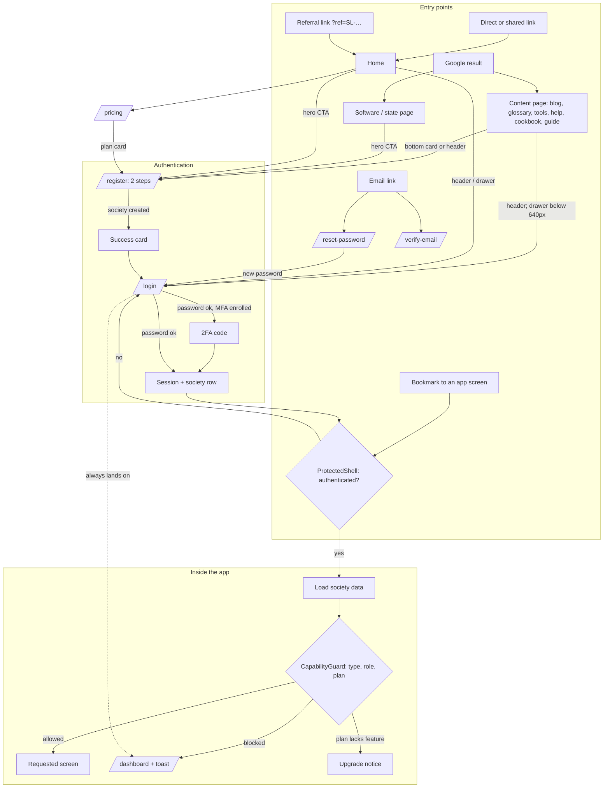
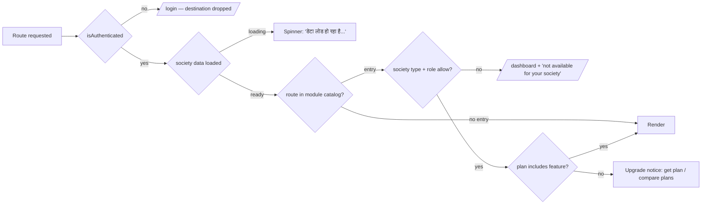
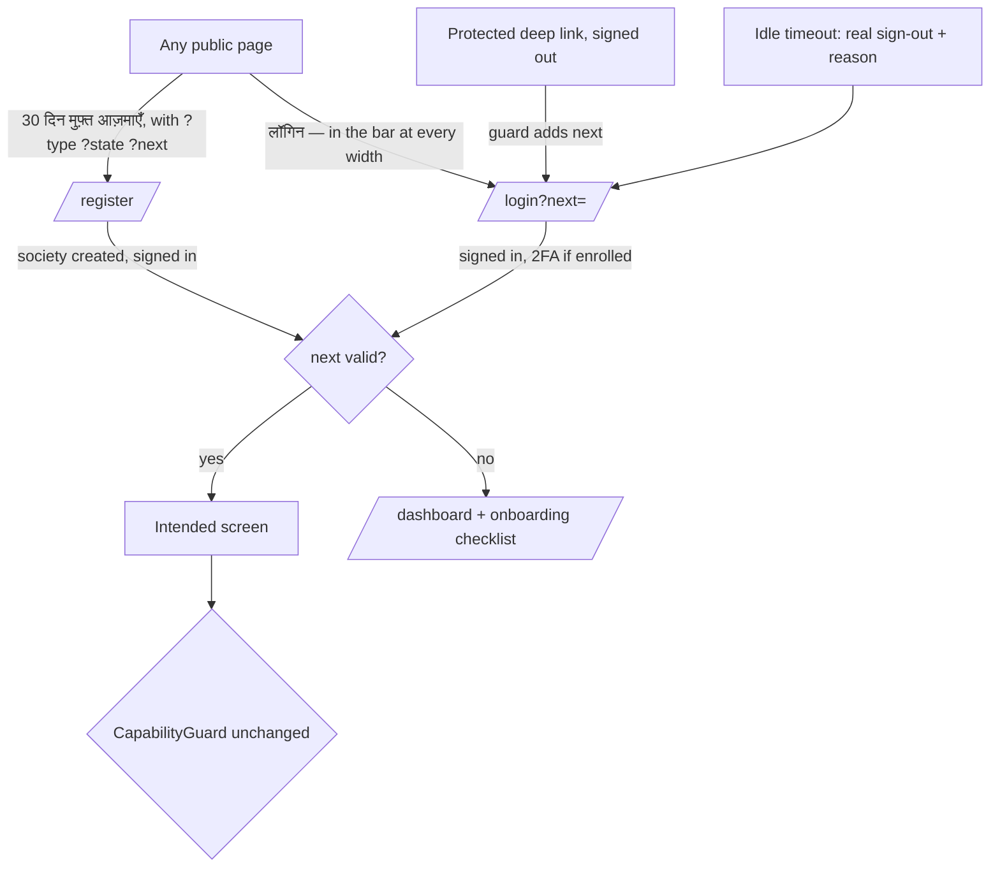

# SahakarLekha — Route-by-Route Journey Map

**Date:** 2026-11-16 · **Source of truth:** `src/App.tsx:295-503` on branch `feat/cd-withdrawal-setting` · Read-only audit.

**Main report:** [SAHAKARLEKHA-USER-JOURNEY-CONVERSION-AUDIT.md](SAHAKARLEKHA-USER-JOURNEY-CONVERSION-AUDIT.md). Finding ids (J-, S-, M-, C-) refer to it.

This document follows a person from the first public page to the correct society dashboard, one route at a time. Line numbers for the public content pages come from a research sub-agent's read of the code; the auth routes (`/login`, `/register`, `/reset-password`, `/verify-email`) and the guards were read by the auditor directly. The header and the three auth pages were also measured in the running dev build at 320 px.

---

## 1. The whole journey on one page

Two properties of this picture are the main journey defects: every arrow into `/login` forgets where the person wanted to go (J-3), and `/register` ends at `/login` rather than inside the app (J-4).

---

## 2. Shared header and footer (`src/components/PublicLayout.tsx`)

Used by every content page. Sticky, 64 px tall.

| Width | What the bar shows | Login reachable in |
|---|---|---|
| < 640 px | Logo · **रजिस्टर** · menu icon | 2 taps (menu → first item) — measured at 320 px |
| 640–767 px | Logo · language · **लॉगिन** · **रजिस्टर** · menu icon | 1 tap |
| 768–1023 px | + nav (मूल्य, गाइड, ब्लॉग, मदद) | 1 tap |
| ≥ 1024 px | Register label becomes **शुरू करें / Get Started** | 1 tap |
| Signed in (any width) | One button: **डैशबोर्ड** → `/dashboard` | — |

Mobile drawer, in order: language switch · लॉगिन · मूल्य · गाइड · एंट्री कुकबुक · मदद केंद्र · कैलकुलेटर · मुफ्त प्रारूप · ब्लॉग · सामान्य प्रश्न · पूछें · हमारे बारे में · संपर्क.

Footer: society-type links to `/software/<type>`, quick links to content and legal pages. **No `/login`, `/register`, `/downloads` or `/partner` link; no company name, address, phone or GSTIN.**

Prerendered HTML (what a visitor or crawler gets before JavaScript): a logo-only bar, an "और देखें" link list that includes `/register`, and **no `/login` link anywhere**.

---

## 3. Entry routes, one by one

Columns: **Offer clear?** (can a stranger tell what SahakarLekha is) · **Next step** (the CTA and where it sits) · **Context kept?** (does anything about this page reach `/register` or `/login`) · **Issues**.

### 3.1 Home and commercial pages

| Route | Offer clear? | Next step | Context kept? | Issues |
|---|---|---|---|---|
| `/` | Yes — headline, audience (PACS, dairy, marketing, consumer…), price line, all above the fold at 320 px | Hero: **शुरू करें** → `/register`; **देखें कैसे काम करता है** → `#demo` (video). Final band: **पंजीकरण** → `/register`, WhatsApp | Only `?ref=` (stored for 90 days) | Hero does not mention the 30-day trial (C-1). Page is 13,156 px tall at 320 px with no register CTA between the hero and the end (C-7). Hero buttons are `<a>` wrapping `<button>` (M-10). Hero and header CTAs untracked |
| `/pricing` | Yes — three plans with amounts, "+ GST", 30-day trial, 1 user | Every plan card and the bottom band: **30 दिन मुफ़्त आज़माएँ** → `/register`. Enterprise → `/contact` | No — the chosen plan is not passed (correct: the trial is the same for all) | No CTA in the hero. No refund terms on the page. Zero analytics events |
| `/software` | Yes | **रजिस्टर करें** → `/register`; **मुफ़्त गाइड** → `/guide`, below the type grid | No | — |
| `/software/:type` | Yes — per-type modules, real screenshots, FAQ | Hero **शुरू करें** → `/register`; mid-page trial note → `/pricing`; bottom **रजिस्टर करें** + **डेमो/संपर्क** → `/contact` | **No — the type must be chosen again on Register** (J-10) | Step text says "choose type «X»; the trial starts at once" — true, but the form does not pre-select it. "डेमो" leads to a generic message form (J-17) |
| `/cooperative-software/:state` | Yes | Hero **शुरू करें** → `/register`; bottom **रजिस्टर करें** + **डेमो/संपर्क** | **No — the state is not passed** (J-10) | Same as above |
| `/about` | Mission and values; no named people or legal entity | Header only | — | No CTA in the body |
| `/contact` | Email, WhatsApp number, hours, "India" as the address | Contact form; header | — | No register CTA; email is not a `mailto:` link |
| `/faq` | Yes | Bottom band: **रजिस्टर करें** → `/register`; **संपर्क करें** | No | — |

### 3.2 Content pages (organic search entry)

| Route | Next step | Context kept? | Issues |
|---|---|---|---|
| `/blog` | Bottom band **शुरू करें** → `/register` | No | — |
| `/blog/category/:cat` | Header only | — | No CTA in the body |
| `/blog/:slug` | Bottom card: "…₹2,999/year + GST से" **रजिस्टर करें** → `/register`; **संपूर्ण गाइड** → `/guide`. After a "helpful" vote: → `/register` | Analytics only (`post`) | Nothing above the fold or mid-article except an email-capture box on long posts (experiment E-8) |
| `/author/:slug`, `/editorial-policy` | Header only | — | Trust pages; fine |
| `/glossary` | Header only | — | — |
| `/glossary/:slug` | "इसे SahakarLekha में करें" buttons → **app routes** (`/vouchers`, `/members`…); bottom card **रजिस्टर करें** | Analytics only (`term`) | For a logged-out visitor the module buttons bounce to `/login` and then to the dashboard (J-18) |
| `/tools` | Bottom card: "…बिल्कुल मुफ्त" **मुफ्त रजिस्टर करें** → `/register` | No | "Completely free" contradicts the pricing (J-5b) |
| `/tools/:slug` | Bottom card **मुफ्त रजिस्टर करें** → `/register` | No | Same; JSON-LD `price: '0'` |
| `/downloads` | One text link → `/register` | No | Reachable only from the mobile drawer — not in the desktop nav or footer |
| `/help` | Search and task links | — | No register CTA (fine: help audience is mostly existing users) |
| `/help/:slug` | Full-width button above the steps and again at the bottom. Signed in → the app screen. **Signed out → `/register?next=<screen>`** | `next` is **sent but never read** (J-3) | Best-intent entry point in the site, and the context is dropped |
| `/cookbook` | Entry links | — | — |
| `/cookbook/:slug` | Mid-page button, e.g. "App में बिक्री दर्ज करें". Signed out → `/register?next=<screen>` | `next` sent, never read | The label promises the app screen; the click lands on a registration form (C-6) |
| `/guide` | Bottom card **अभी शुरू करें** → `/register`; quick start; FAQ | No | "गाइड मुफ़्त है; सहकार लेखा ₹2,999/साल + GST से" — accurate |
| `/guide/quick-start` | Bottom **अभी शुरू करें** → `/register`; support; FAQ | No | — |
| `/guide/:slug`, quiz, certificate, verify | "Helpful" widget only | No | Learning pages; a CTA is not needed on each |
| `/search`, `/ask` | Header only | — | — |
| `*` (404) | Home, guide, cookbook, help, ask, contact, search | — | No register or pricing link; acceptable |

### 3.3 Referral, partner and member entries

| Route | Who | What happens | Issues |
|---|---|---|---|
| any URL with `?ref=SL-XXXXXX` | Visitor sent by a partner | Code stored in localStorage (first touch, 90 days) and pre-filled on Register step 2, with a disclosure of what the partner will see | Works. The disclosure is good practice |
| `/partner`, `/partner/status` | Prospective partner | Application and status | Not linked from header, drawer or footer |
| `/partner/login`, `/partner/portal` | Partner | Email + one-time code; separate session from staff login | — |
| `/member/:societyId` (and old `/sadasya/…`) | A society's member | Member number + PIN; own auth client; read-only statement | A member who opens `/login` by mistake gets no pointer here (J-16). The society id is visible in this public URL (relevant to S-1) |
| `/verify-backup` | Auditor / registrar with a `.slbak` file | Verifies in the browser, no account | No navigation at all on the page |

---

## 4. Authentication routes

### 4.1 `/login`

| Aspect | Today |
|---|---|
| Guard | `PublicRoute`: already signed in → `/dashboard` (`App.tsx:249-257`) |
| Layout | Own split layout; no site header; logo is not a link |
| Fields | Email, password (show/hide) |
| Links | Forgot password (dialog) · Forgot User ID (dialog) · Register (`<a href>`, full reload) · 1-minute demo (`/#demo`) · WhatsApp help |
| Success | `navigate('/dashboard')` — always (`Login.tsx:55,89`) |
| MFA | Second step when enrolled: 6-digit code or recovery code; Back returns to the password step |
| Failure | "गलत ईमेल या पासवर्ड" for wrong password, no network, service error, rate limit and inactive account alike (J-1) |
| Reads from URL | Nothing — no `next`, no `from`, no email prefill |
| Mobile (320 px, measured) | No overflow; inputs 223×40; login button 223×44; show/hide 16×16 with no name; forgot-password 72×16; no `autocomplete` |

### 4.2 `/register`

| Aspect | Today |
|---|---|
| Guard | `PublicRoute`: signed in → `/dashboard` |
| Step 1 | Society name (EN)\*, name (HI), registration no.\*, district\*, state\*, phone, GSTIN, address, society type\*, financial year |
| Step 2 | Admin name\*, email\*, password\* (min 6), confirm\*, referral code |
| Server call | `register_society` (anonymous RPC): society + confirmed admin login + settings + chart of accounts, all-or-nothing. A DB trigger starts the 30-day, 1-seat trial |
| Success | Card: "पंजीकरण सफल!" with the login email and **लॉगिन पर जाएँ →** `/login` (J-4) |
| Failure | Duplicate registration number · duplicate email · society exists · raw server text for anything else |
| Reads from URL | Nothing. Referral comes from localStorage |
| Missing on the page | Trial, price, terms, privacy, any link except "login" (J-5) |
| Mobile (320 px, measured) | Step 1 is 1,331 px tall; none of the 10 labels is tied to its input; no `autocomplete`; phone is a plain text field |

### 4.3 `/reset-password`

Reached only from the emailed link. Shows the form when Supabase establishes the recovery session; after 3 seconds without one, "link invalid or expired" with a button to `/login`. On success: "redirecting to login" → `/login`. Because the recovery session is a real session, a user without 2FA is in fact already signed in and `PublicRoute` forwards them to `/dashboard`; the on-screen text says otherwise. **Not verified:** the behaviour for a 2FA-enrolled user, whose recovery token is marked `mfa_pending` and is signed out by the auth provider on load (`AuthContext.tsx:242-246`) — this may interrupt the reset and should be tested on staging.

### 4.4 `/verify-email`, `/email-unsubscribe`

Public pages that consume a one-time token. Both end with a button to `/dashboard`; a signed-out user is then sent to `/login` and, after login, reaches the dashboard — the one case where losing the destination does no harm.

---

## 5. Protected routes — what stands between login and the screen

Every route in `App.tsx:349-492` is wrapped the same way:

| Destination | Extra gate | Lands on when blocked |
|---|---|---|
| `/dashboard`, `/my-dashboard` | none | — |
| Books and reports (`/cash-book`, `/vouchers`, `/trial-balance`, …) | role | `/dashboard` + toast |
| Society-type modules (`/milk-collection`, `/flats-register`, `/procurement-lots`, `/retail-counter`, …) | society type / capabilities | `/dashboard` + toast |
| `/user-management` | admin (secretary via the 17-role map) | `/dashboard` + toast — this is where every expiry banner points (J-7) |
| `/payroll`, multi-branch, consolidation | plan feature | Upgrade notice |
| `/super-admin/*` | `SuperAdminRoute` (platform admin) | `/dashboard`, or `/login` if signed out |
| Retired paths (`/receive-payment`, `/make-payment`, `/reserve-fund`, `/profit-distribution`, `/compound-voucher`) | plain redirect to the successor screen | — |

Client-side gates are presentation only; data access is decided by row-level security on the server.

---

## 6. Journeys by user type — step counts today

A "step" is a page load or a form submission the user must complete.

| User | Path today | Steps | Where it breaks |
|---|---|---|---|
| Returning staff, desktop | Home → Login → Dashboard | 2 | — |
| Returning staff, phone | Home → menu → Login → Dashboard | 3 | Login not in the bar (J-9) |
| Returning staff, bookmark to `/vouchers`, session ended | `/vouchers` → Login → Dashboard → find Vouchers | 3 + navigation | Destination lost (J-3) |
| New admin from the dairy software page | Software page → Register step 1 (re-choose type, state) → step 2 → success card → Login (re-type credentials) → Dashboard | 5 | J-10, J-4 |
| New admin from a Cookbook recipe | Recipe → Register (2 steps) → success → Login → Dashboard → find the screen | 5 + navigation | J-3, J-4 |
| Invited accountant | Admin: User Management → add user with a password → tells the accountant by phone. Accountant: Login → Dashboard | 2 for each side, plus an out-of-band password | Not possible during the 1-seat trial (J-6) |
| Forgot password | Login → dialog → email → Reset page → Login/Dashboard | 4 | Works; failure branch misleads (J-2b) |
| Forgot login email | Login → dialog → "request noted" | 2 | Nothing happens (J-2) |
| Deactivated user | Login → "invalid email or password" | 1, repeated | Wrong message (J-8) |
| Admin, plan expired | Login → Dashboard (banner) → User Management → pay (Razorpay) → reload | 4 | Reload after a fixed 2.5 s; no "pending" state *(not verified)* |
| Staff, plan expired | Login → Dashboard (banner) → User Management → bounced to Dashboard | dead end | J-7 |
| Accountant with two societies | Second society: "A login already exists" | blocked | One email, one society (J-19) |

---

## 7. Target map (after the recommended changes)

Step counts under the target: new admin from a software page **3** (page → 2 form steps → dashboard); Cookbook reader **3**, ending on the intended screen; returning phone user **2**; expired-session bookmark **2**, ending on the bookmarked screen.

The validation rule for `next`, the per-screen specification and the sprint plan are in sections 15 and 17 of the main report.
